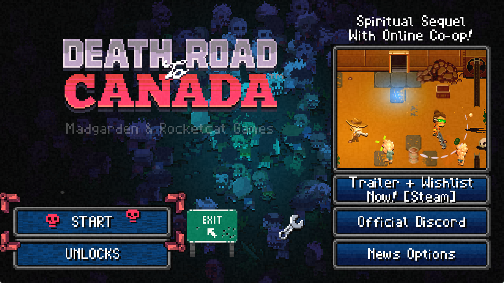
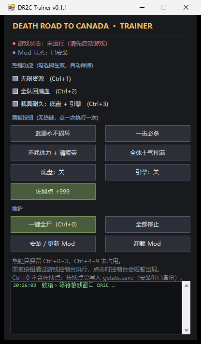

<div align="center">

<h1>Death Road to Canada · Trainer</h1>

<p><b>A PowerShell + <code>deathforth</code> trainer for the single-player Steam release.</b><br>
No process injection · No memory editing · Effects last only for the current session</p>

<p>
  <a href="CHANGELOG.md"></a>
  <a href="LICENSE"></a>
  
  
  
</p>

<p><b>English</b> · <a href="README.zh-CN.md">简体中文</a></p>

</div>

---

## Overview

A trainer for the single-player game **Death Road to Canada** (Steam release).
It is built entirely from PowerShell scripts plus the game's built-in `deathforth` script engine: **no process injection, no memory editing, no run-save modification**.

- The panel UI is compiled and run in memory.
- Every effect exists only in the current game session and is fully reverted when you quit.
- The only deliberate exception is **Zombo Points**: they live in the global stats file, so that one panel button writes `gstats.save` (backed up automatically on install).
- Delete `deathforth\hack\hack.df` to return to vanilla.

> **Table of contents**
> [Screenshots](#screenshots) · [Supported game version](#supported-game-version) · [Features and hotkeys](#features-and-hotkeys) · [Panel buttons](#panel-buttons) · [Installation](#installation) · [Usage](#usage) · [Uninstallation](#uninstallation) · [Script warnings](#script-warnings) · [Repository layout](#repository-layout) · [Disclaimer](#disclaimer) · [License](#license)

---

## Screenshots

<div align="center">
  
  <br>
  <em>The game's main menu.</em>
</div>

<br>
<br>

<div align="center">
  
  <br>
  <em>Three auto-maintained checkboxes, one-click action buttons and a live log.</em>
</div>

---

## Supported game version

| Item | Value |
| --- | --- |
| Game | **Death Road to Canada** (Steam release) |
| Tested version | **JUN-20-2024.10.25** |
| OS | Windows 10 / 11 |
| Dependency | The game's own `deathforth` folder and `boot.df` |

Other game versions may work, but could break if the `deathforth` script API changes.

---

## Features and hotkeys

Hotkeys are kept to a minimum so that `Ctrl+4`~`Ctrl+9` stay free for future features.

| Hotkey | What it does |
| :---: | --- |
| `Ctrl+0` | **Everything at once**: resources, heal, weapons never break, no stamina + clear fatigue, one-hit kill, morale, car durability. *Zombo Points are not included.* |
| `Ctrl+1` | **Infinite resources**: food / gas / medical up to 500, bullets / shotgun shells / rifle shells up to 300 |
| `Ctrl+2` | **Full heal** for the whole team |
| `Ctrl+3` | **Car durability**: chassis and engine locked at max together (immune to crashes, roadblocks and driving wear) |

- `Ctrl+4`~`Ctrl+9` are not bound by this tool; `Ctrl+9` remains the game's built-in debug console.
- Hotkeys are delivered straight to the game window as window messages — no need to open or close the in-game console.
- Ticked options in the panel are re-applied automatically; `Ctrl+0` enables every effect except Zombo Points.

---

## Panel buttons

Functions without a hotkey live on the panel as one-click buttons.

| Panel button | Effect |
| --- | --- |
| Weapons never break | Current weapons of the whole team never wear out (click again after switching weapons) |
| No stamina + clear fatigue | Swinging weapons costs no stamina, and clears the **TIRED** status of the whole team |
| One-hit kill | Current weapons of the whole team one-shot enemies |
| Max team morale | Raises every member's morale to the cap |
| Chassis: on/off | Independent chassis guard toggle |
| Engine: on/off | Independent engine guard toggle |
| Zombo Points +999 | One-shot grant of 999 points (writes `gstats.save`) |
| Everything on | Same as `Ctrl+0` (Zombo Points excluded) |
| Stop all | Unchecks the auto-maintained options and turns the car guards off |

> Panel buttons are executed through the game's own console, which briefly appears on click. This is how they work without occupying `Ctrl+4`~`Ctrl+9`.

---

## Installation

1. Close the game first.
2. Double-click `install.bat` (if the game is under `Program Files`, you may need to right-click → **Run as administrator**).
3. Seeing `Installed:` means success; saves are backed up to `backup\` automatically.
4. Restart the game once for it to take effect.

---

## Usage

1. Launch the game through Steam and reach the main menu.
2. Double-click `start-panel.bat` (or `启动面板.bat`).
3. When the panel reports a connected DR2C window, tick the features you want.
4. You can also skip the panel and press `Ctrl+0`~`Ctrl+3` in-game.

> If double-clicking a `.bat` does nothing, right-click it and choose **Run as administrator**.

---

## Uninstallation

1. Close the game first.
2. Double-click `uninstall.bat`. It removes only `deathforth\hack\hack.df`, returning the game to vanilla immediately. (The folder is removed as well if it becomes empty; other mod files inside it are left untouched.)
3. This tool never modifies the run save files; the only exception is the Zombo Points button, which writes the global stats file. To restore the pre-install state, copy `gstats.save` back from `backup\`.

---

## Script warnings

- `.ps1` / `.bat` files downloaded from the internet carry the Mark-of-the-Web, so PowerShell / SmartScreen may warn that "this script is not trusted" and block execution. This is not a virus: right-click the file → Properties → tick **Unblock**, or run `unblock.bat` (`解除锁定.bat`) to unblock everything at once.
- The scripts use `-ExecutionPolicy Bypass` only to temporarily bypass the local execution policy for this tool; they do not change the system-wide policy.

---

## Repository layout

```
dr2c-trainer/
├─ install.bat                 install (copies hack.df into the game folder and backs up saves)
├─ uninstall.bat               uninstall (removes only hack.df)
├─ start-panel.bat             launch the panel (English alias)
├─ 启动面板.bat                 launch the panel (original Chinese name, same content)
├─ unblock.bat                 remove the Mark-of-the-Web (English alias)
├─ 解除锁定.bat                 remove the Mark-of-the-Web (original Chinese name, same content)
├─ hack/
│  └─ hack.df                  in-game script, copied to deathforth\hack\ on install
├─ tools/
│  ├─ install.ps1              install logic
│  ├─ uninstall.ps1            uninstall logic
│  ├─ panel.ps1                WinForms panel (embedded C#, compiled in memory)
│  └─ unblock.ps1              batch unblock
├─ docs/
│  └─ panel.png                panel screenshot used by the README
├─ backup/                     save backups created on install (ignored by .gitignore)
├─ README.md                   English documentation (GitHub front page)
├─ README.zh-CN.md             Chinese documentation
├─ CHANGELOG.md                changelog
└─ LICENSE
```

---

## Disclaimer

- This tool is for **single-player / offline** use only. Do not use it in multiplayer, leaderboards, or any other online scenario.
- Please support the official game. You are responsible for any consequences such as save corruption, disabled achievements, crashes, or anything else caused by using this tool.
- This project is not affiliated with the game's developer, publisher, or Valve / Steam.
- This tool collects and uploads no data, and does not modify run save files. The Zombo Points grant is the only function that writes to disk (`gstats.save`).

---

## License

[MIT](LICENSE)
