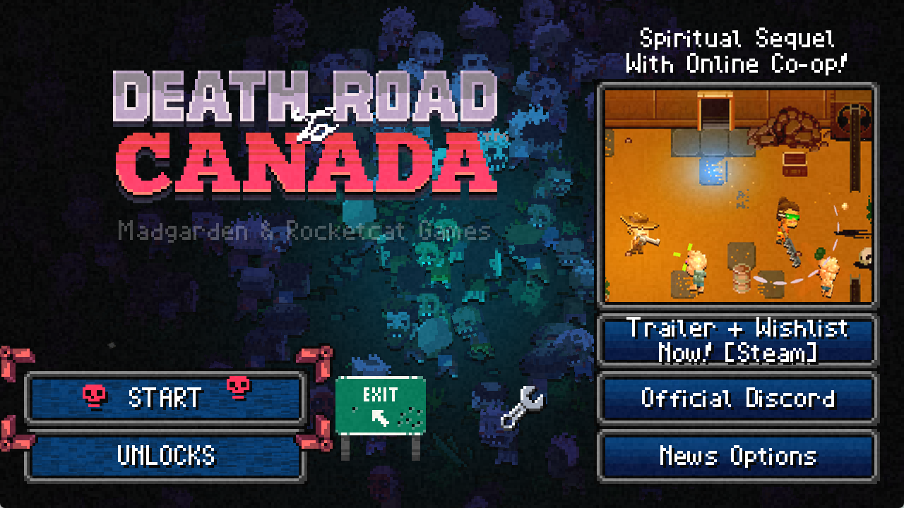
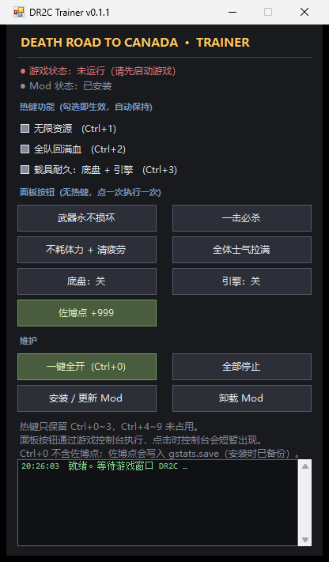

<div align="center">

<h1>Death Road to Canada · 修改器</h1>

<p><b>基于 PowerShell + <code>deathforth</code> 的单机修改器（Steam 正式版）</b><br>
不注入进程 · 不修改内存 · 效果仅在当前游戏会话内有效</p>

<p>
  <a href="CHANGELOG.md"></a>
  <a href="LICENSE"></a>
  
  
  
</p>

<p><a href="README.md">English</a> · <b>简体中文</b></p>

</div>

---

## 简介

一款给单机游戏 **Death Road to Canada**（死亡之路，Steam 正式版）用的修改器。
全部由 PowerShell 脚本 + 游戏自带的 `deathforth` 脚本引擎实现：**不注入进程、不修改内存、不改流程存档**。

- 面板界面在内存中编译运行。
- 所有效果只存在于当前游戏会话，退出游戏即完全还原。
- 唯一的例外是**佐博点**：佐博点存在全局统计存档里，只有对应的面板按钮会写入 `gstats.save`（安装时自动备份）。
- 删除 `deathforth\hack\hack.df` 即可回到原版。

> **目录**
> [截图](#截图) · [适用游戏版本](#适用游戏版本) · [功能与热键](#功能与热键) · [面板按钮](#面板按钮) · [安装](#安装) · [使用](#使用) · [卸载](#卸载) · [不受信任提示](#不受信任提示) · [目录结构](#目录结构) · [免责声明](#免责声明) · [许可证](#许可证)

---

## 截图

<div align="center">
  
  <br>
  <em>游戏主界面。</em>
</div>

<br>
<br>

<div align="center">
  
  <br>
  <em>三个自动保持的勾选项、一组一键按钮，以及实时日志。</em>
</div>

---

## 适用游戏版本

| 项目 | 说明 |
| --- | --- |
| 游戏 | **Death Road to Canada**（Steam 正式版） |
| 实测版本 | **JUN-20-2024.10.25** |
| 系统 | Windows 10 / 11 |
| 依赖 | 游戏自带的 `deathforth` 目录与 `boot.df` |

其他版本可能可用，也可能因 `deathforth` 脚本接口变化而失效。

---

## 功能与热键

热键刻意保持精简，把 `Ctrl+4`~`Ctrl+9` 留给以后的重要功能。

| 热键 | 功能 |
| :---: | --- |
| `Ctrl+0` | **一键全开**：资源、回血、武器不坏、不耗体力 + 清疲劳、一击必杀、士气、载具耐久。*不含佐博点。* |
| `Ctrl+1` | **无限资源**：食物 / 汽油 / 医疗包补到 500，子弹 / 霰弹 / 步枪弹补到 300 |
| `Ctrl+2` | **全队回满血** |
| `Ctrl+3` | **载具耐久**：底盘和引擎一起锁满（撞车、路障、行驶磨损都不掉） |

- `Ctrl+4`~`Ctrl+9` 本工具不占用；`Ctrl+9` 仍是游戏自带的调试控制台。
- 热键直接以窗口消息投递给游戏窗口，不需要打开或关闭游戏内控制台。
- 面板里勾选的项会自动保持；`Ctrl+0` 会开启除佐博点外的全部效果。

---

## 面板按钮

没有热键的功能都放在面板上，以一键按钮的形式提供。

| 面板按钮 | 作用 |
| --- | --- |
| 武器永不损坏 | 全队当前武器不磨损（换武器后再点一次） |
| 不耗体力 + 清疲劳 | 挥武器不耗体力，并清除全队 **疲劳（TIRED）** 状态 |
| 一击必杀 | 全队当前武器一击必杀 |
| 全体士气拉满 | 所有队员士气拉到上限 |
| 底盘：开/关 | 单独开关底盘保护 |
| 引擎：开/关 | 单独开关引擎保护 |
| 佐博点 +999 | 单次加 999 佐博点（写入 `gstats.save`） |
| 一键全开 | 等同 `Ctrl+0`（不含佐博点） |
| 全部停止 | 取消自动保持的勾选，并关闭载具保护 |

> 面板按钮通过游戏自带控制台执行，点击时控制台会短暂出现——这是它们不占用 `Ctrl+4`~`Ctrl+9` 的代价。

---

## 安装

1. 先关闭游戏。
2. 双击 `install.bat`（若安装在 `Program Files` 下，可能需要右键「以管理员身份运行」）。
3. 看到 `Installed:` 字样即成功，存档会自动备份到 `backup\`。
4. 重新启动一次游戏后生效。

---

## 使用

1. 先通过 Steam 启动游戏，进入主菜单。
2. 双击 `start-panel.bat`（或 `启动面板.bat`）。
3. 面板顶部显示已连接 DR2C 窗口后，勾选需要的功能。
4. 也可以不开面板，直接在游戏里按 `Ctrl+0`~`Ctrl+3`。

> 若双击 `.bat` 没反应，请右键「以管理员身份运行」。

---

## 卸载

1. 先关闭游戏。
2. 双击 `uninstall.bat`，只删除 `deathforth\hack\hack.df`，游戏立即回到原版。
   （若该目录为空会一并删除；目录内其他 mod 文件不会被误删。）
3. 本工具不改动流程存档；唯一例外是佐博点按钮，它会写入全局统计存档。如需恢复安装前的状态，从 `backup\` 把 `gstats.save` 拷回即可。

---

## 不受信任提示

- 从网络下载的 `.ps1` / `.bat` 会带有「网络来源」标记，部分环境下 PowerShell / SmartScreen 会提示「此脚本不受信任」并拦截执行；这不是病毒，可右键文件 → 属性 → 勾选「解除锁定」，或直接运行 `unblock.bat`（`解除锁定.bat`）批量解除。
- 脚本使用 `-ExecutionPolicy Bypass` 仅用于临时绕过本地执行策略以运行本工具，不修改系统全局策略。

---

## 目录结构

```
dr2c-trainer/
├─ install.bat                 安装（复制 hack.df 到游戏目录，并备份存档）
├─ uninstall.bat               卸载（仅删除 hack.df）
├─ start-panel.bat             启动面板（英文别名）
├─ 启动面板.bat                 启动面板（中文原名，内容相同）
├─ unblock.bat                 解除文件网络锁定（英文别名）
├─ 解除锁定.bat                 解除文件网络锁定（中文原名，内容相同）
├─ hack/
│  └─ hack.df                  游戏内脚本，安装时复制到 deathforth\hack\
├─ tools/
│  ├─ install.ps1              安装逻辑
│  ├─ uninstall.ps1            卸载逻辑
│  ├─ panel.ps1                WinForms 面板（C# 内嵌，内存编译）
│  └─ unblock.ps1              批量解除锁定
├─ docs/
│  └─ panel.png                面板截图，供 README 使用
├─ backup/                     安装时自动生成的存档备份（已在 .gitignore 中忽略）
├─ README.md                   英文说明（GitHub 主页）
├─ README.zh-CN.md             中文说明
├─ CHANGELOG.md                更新日志
└─ LICENSE
```

---

## 免责声明

- 本工具仅用于**单机 / 离线**模式，请勿用于联机、排行榜或任何多人场景。
- 请支持正版游戏。使用本工具造成的存档异常、成就失效、游戏崩溃或其他任何后果，由使用者自行承担。
- 本项目与游戏开发商、发行商及 Valve / Steam 无任何关联。
- 本工具不收集、不上传任何数据，也不修改流程存档；佐博点按钮是唯一会写盘（`gstats.save`）的功能。

---

## 许可证

[MIT](LICENSE)
